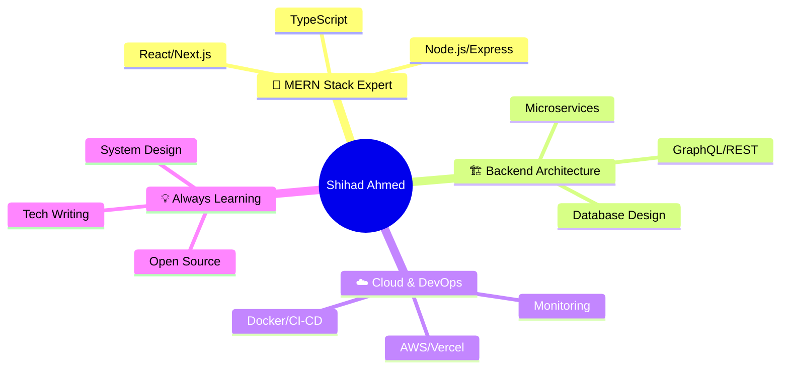

  

  
  
  
  
  

---

### 👨‍💻 About Me

  

| **Currently Building** | **Exploring** | **Advocating** |
|:---:|:---:|:---:|
| 🚀 Scalable SaaS Products | 🧠 AI/ML Integration | 📝 Clean Architecture |
| 🔄 Real-time Systems | 🌐 Edge Computing | 🧪 Test-Driven Development |
| 📊 Developer Tooling | 🔐 Web3 & Crypto | 🤝 Open Source Culture |

> *"Code is not just syntax—it's a craft. Every line tells a story of problem-solving, creativity, and continuous growth."*

---

### 🛠️ Tech Stack

#### **Frontend Universe**

#### **Backend Cosmos**

#### **Cloud & DevOps Galaxy**

---

### 📊 GitHub Analytics

  
|  |  |

---

### 🔥 Contribution Streak

  

---

### 📈 Activity Graph

  

---

### 🏆 Trophy Case

  

---

### 🚀 Featured Projects

| Project | Description | Tech Stack | Status | Links |
|:---|:---|:---:|:---:|:---:|
| **E-Commerce Platform** | Full-stack marketplace with real-time inventory, payments & analytics | `Next.js` `TypeScript` `PostgreSQL` `Redis` `Stripe` | 🚀 **Live** | [🔗 Demo](https://example.com) \| [📦 Repo](https://github.com) |
| **TaskFlow** | Collaborative project management with drag-drop boards, real-time sync | `React` `Node.js` `Socket.io` `MongoDB` `Tailwind` | 🛠️ **WIP** | [📦 Repo](https://github.com) |
| **DevMetrics** | GitHub analytics dashboard for engineering teams | `React` `GraphQL` `TypeScript` `Vercel` | ✅ **Done** | [🔗 Demo](https://example.com) \| [📦 Repo](https://github.com) |
| **API Gateway** | High-performance gateway with rate limiting, auth, monitoring | `Go` `Redis` `Docker` `Kubernetes` | 🧪 **Beta** | [📦 Repo](https://github.com) |

---

### 📝 Latest Blog Posts

<!-- BLOG-POST-LIST:START -->
- [Building Scalable Microservices with Node.js](https://dev.to/your-devto/microservices-nodejs)
- [TypeScript Patterns That Save Hours](https://dev.to/your-devto/typescript-patterns)
- [Mastering React Server Components](https://dev.to/your-devto/react-server-components)
<!-- BLOG-POST-LIST:END -->

---

### 🤝 Let's Connect & Collaborate

---

### 🌟 Support My Work

---

  
    
  ✨ Last updated: <code>2026</code> • Crafted with ❤️ using 
  <a href="https://github.com/anuraghazra/github-readme-stats">github-readme-stats</a> • 
  <a href="https://github.com/ashutosh00710/github-readme-activity-graph">activity-graph</a> • 
  <a href="https://github.com/ryo-ma/github-profile-trophy">github-profile-trophy</a> • 
  <a href="https://skillicons.dev">skillicons</a>

  

<!--
**Design Notes:**
- Theme: Tokyo Night (consistent dark aesthetic)
- Animations: Capsule render fadeIn, SVG badge hover effects
- Icons: skillicons.dev (SVG, scalable, consistent)
- Charts: tokyonight theme across all widgets
- Layout: Table-based for alignment, responsive
- Colors: #7aa2f7 (primary), #bb9af7 (accent), #c0caf5 (text), #1a1b26 (bg)
-->