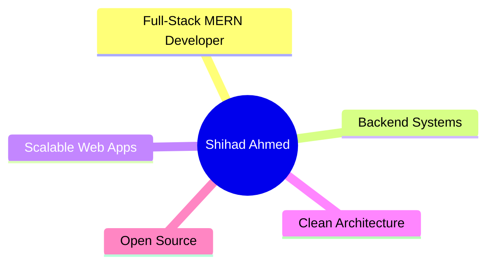

  

  
  
  
  

---

### 👨‍💻 About Me

| 🎯 **Focus** | 💡 **Passion** | 🛠️ **Approach** |
|:---:|:---:|:---:|
| MERN Stack | Robust Backends | Clean Code |
| TypeScript | System Design | TDD |
| Cloud (AWS/Vercel) | Performance | Documentation |

> **Currently exploring:** Advanced TypeScript patterns · Micro-frontends · Edge computing

---

### 🛠️ Tech Stack

#### Frontend

#### Backend

#### DevOps & Tools

---

### 📊 GitHub Analytics

  
| Stats | Top Languages |
|:---:|:---:|
|  |  |

---

### 🔥 Contribution Streak

  

---

### 📈 Activity Graph

  

---

### 🏆 Featured Projects

| Project | Description | Tech | Status |
|:---|:---|:---:|:---:|
| **Project Alpha** | Scalable e-commerce platform with real-time inventory | `MERN` `Redis` `Socket.io` | 🚀 Live |
| **TaskFlow** | Team collaboration tool with drag-and-drop boards | `Next.js` `Prisma` `PostgreSQL` | 🛠️ WIP |
| **DevMetrics** | GitHub analytics dashboard for teams | `React` `GraphQL` `TypeScript` | ✅ Done |

---

### 🤝 Let's Connect

---

  
   
  Last updated: <code>2026</code> • Built with ❤️ using <a href="https://github.com/anuraghazra/github-readme-stats">github-readme-stats</a>

  

