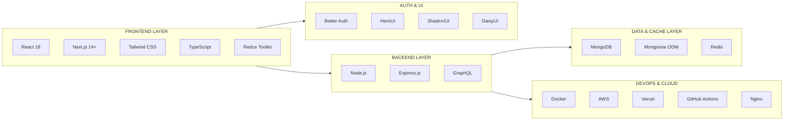

<pre align="center">
███████╗██╗  ██╗███████╗██╗     ███████╗ ██████╗██████╗ ██████╗ ███████╗██████╗ 
██╔════╝██║  ██║██╔════╝██║     ██╔════╝██╔════╝██╔══██╗██╔══██╗██╔════╝██╔══██╗
███████╗███████║█████╗  ██║     █████╗  ██║     ██████╔╝██████╔╝█████╗  ██████╔╝
╚════██║██╔══██║██╔══╝  ██║     ██╔══╝  ██║     ██╔══██╗██╔═══╝ ██╔══╝  ██╔══██╗
███████║██║  ██║███████╗███████╗███████╗╚██████╗██║     ██║     ███████╗██║  ██║
╚══════╝╚═╝  ╚═╝╚══════╝╚══════╝╚══════╝ ╚═════╝╚═╝     ╚═╝     ╚══════╝╚═╝  ╚═╝
</pre>

<p align="center">
  <code>Full-Stack MERN Developer  •  Dhaka, Bangladesh</code>
</p>

<p align="center">
  <a href="https://github.com/shihadahmed"><code>[ GitHub ]</code></a>  •
  <a href="https://linkedin.com/in/shihadahmed"><code>[ LinkedIn ]</code></a>  •
  <a href="https://shihadahmed.vercel.app"><code>[ Portfolio ]</code></a>  •
  <a href="mailto:shihadahmed@example.com"><code>[ Email ]</code></a>  •
  <a href="https://twitter.com/shihadahmed"><code>[ Twitter ]</code></a>
</p>

<pre>
--------------------------------------------------
</pre>

## 01 // OVERVIEW

```text
> IDENTITY     : Shihad Ahmed
> ROLE         : Full-Stack MERN Developer
> LOCATION     : Dhaka, Bangladesh
> EXPERIENCE   : 4+ years
> STATUS       : Active  //  Open to opportunities
> PHILOSOPHY   : Clean code, scalable architecture, great developer experience
```

```text
> CORE PRINCIPLES
  [x] Scalable SaaS Products
  [x] Real-time Systems
  [x] Clean Architecture
  [x] Type-safe Development
  [x] Developer Experience First
```

```text
> CURRENT FOCUS
  Building production-grade SaaS products with the MERN stack,
  implementing real-time collaborative features, and optimizing
  developer tooling for modern web applications.
```

<pre>
--------------------------------------------------
</pre>

## 02 // ARCHITECTURE & TECH STACK

### SYSTEM TOPOLOGY



### COMPONENT MATRIX

```text
┌─────────────────────────────────────────────────────────────────────────────┐
│                           TECHNOLOGY STACK MATRIX                            │
├──────────────────┬──────────────────────────────────────────────────────────┤
│ CATEGORY         │ TECHNOLOGIES                                             │
├──────────────────┼──────────────────────────────────────────────────────────┤
│ FRONTEND         │ React 18, Next.js 14+ (App Router), TypeScript,         │
│                  │ Tailwind CSS, Redux Toolkit, Vite, TipTap, Yjs          │
├──────────────────┼──────────────────────────────────────────────────────────┤
│ BACKEND          │ Node.js, Express.js, GraphQL, WebSockets,               │
│                  │ REST API Design, Zod Validation                         │
├──────────────────┼──────────────────────────────────────────────────────────┤
│ DATABASE & CACHE │ MongoDB, Mongoose ODM, Redis (Pub/Sub, Caching),        │
│                  │ CRDTs (Yjs) for Real-time Sync                          │
├──────────────────┼──────────────────────────────────────────────────────────┤
│ AUTHENTICATION   │ Better Auth, JWT, OAuth 2.0, Session Management         │
├──────────────────┼──────────────────────────────────────────────────────────┤
│ DEVOPS & CLOUD   │ Docker, AWS (EC2, S3, RDS), Vercel, GitHub Actions,     │
│                  │ Nginx, CI/CD Pipelines                                  │
├──────────────────┼──────────────────────────────────────────────────────────┤
│ UI LIBRARIES     │ HeroUI, Shadcn/UI, DaisyUI, Radix UI Primitives         │
├──────────────────┼──────────────────────────────────────────────────────────┤
│ TOOLING          │ Git, ESLint, Prettier, Husky, Postman, Figma, VS Code   │
└──────────────────┴──────────────────────────────────────────────────────────┘
```

<pre>
--------------------------------------------------
</pre>

## 03 // FEATURED PROJECTS

### 01. SAAS STARTER KIT
```text
> STATUS       : [ LIVE // PRODUCTION ]
> TYPE         : Production-Ready Boilerplate
> ARCHITECTURE : Multi-tenant SaaS with Authentication, Billing, Teams
> STACK        : Next.js 14+  •  TypeScript  •  Tailwind CSS
>                Better Auth  •  Stripe  •  MongoDB  •  Redis
> REPOSITORY   : https://github.com/shihadahmed/saas-starter-kit
> DEPLOYMENT   : https://saas-starter.shihadahmed.vercel.app
```

### 02. REAL-TIME COLLABORATIVE EDITOR
```text
> STATUS       : [ LIVE // PRODUCTION ]
> TYPE         : Google Docs-like Collaborative Editor
> ARCHITECTURE : CRDTs (Yjs) + WebSockets + Presence + Conflict Resolution
> STACK        : React  •  TipTap  •  Yjs  •  WebSockets  •  Node.js  •  Redis
> REPOSITORY   : https://github.com/shihadahmed/realtime-collab-editor
> DEPLOYMENT   : https://collab-editor.shihadahmed.vercel.app
```

### 03. MERN E-COMMERCE PLATFORM
```text
> STATUS       : [ LIVE // PRODUCTION ]
> TYPE         : Scalable REST API with Payments, Orders, Admin Panel
> ARCHITECTURE : Modular Monolith  •  Role-based Access  •  Payment Integration
> STACK        : Node.js  •  Express.js  •  MongoDB  •  Stripe  •  Zod  •  Redis
> REPOSITORY   : https://github.com/shihadahmed/mern-ecommerce-api
> DEPLOYMENT   : https://api.ecommerce.shihadahmed.vercel.app
```

### 04. DEVTOOLS CLI
```text
> STATUS       : [ PUBLISHED // NPM ]
> TYPE         : Scaffolding Tool for MERN Projects with Best Practices
> ARCHITECTURE : Interactive CLI  •  Template Engine  •  Plugin System
> STACK        : TypeScript  •  Commander.js  •  Inquirer  •  Handlebars
> REPOSITORY   : https://github.com/shihadahmed/devtools-cli
> PACKAGE      : npm install -g @shihadahmed/devtools-cli
```

<pre>
--------------------------------------------------
</pre>

## 04 // METRICS & TELEMETRY

### GITHUB ANALYTICS

<div align="center">
  
  
</div>

<div align="center">
  
</div>

<div align="center">
  
</div>

### DETAILED METRICS

<div align="center">
  
</div>

### PROFILE TELEMETRY

<div align="center">
  
</div>

<pre>
--------------------------------------------------
</pre>

## 05 // TIMELINE & ACHIEVEMENTS

### TROPHY CASE

<div align="center">
  <a href="https://github.com/shihadahmed?tab=achievements">
    
  </a>
  <br/>
  <code>View all achievements → https://github.com/shihadahmed?tab=achievements</code>
</div>

### 2024 OBJECTIVES

```text
[ ] Publish 10+ open source packages to npm
[ ] Reach 5,000 GitHub followers
[ ] Contribute to 5 major open source projects
[ ] Speak at 2 tech conferences
[ ] Write 20 technical blog posts
[ ] Launch 2 production SaaS products
```

### EXPERIENCE TIMELINE

```text
2024  ████████████████████████████  Building SaaS Products & Open Source
2023  ██████████████████████████    Real-time Systems & Collaborative Tools
2022  ████████████████████████      MERN E-commerce & Payment Integration
2021  ██████████████████████        Full-Stack Development & Team Leadership
2020  ████████████████████          React Ecosystem & State Management
2019  ████████████████              JavaScript Fundamentals & Node.js
```

<pre>
--------------------------------------------------
</pre>

<p align="center">
  <code>SYSTEM // SHIHAD AHMED  •  LAST SYNC: 2024  •  BUILT WITH MERN STACK</code>
</p>

<p align="center">
  <code>Made with █ by <a href="https://github.com/shihadahmed">Shihad Bin Ahmed</a></code>
</p>